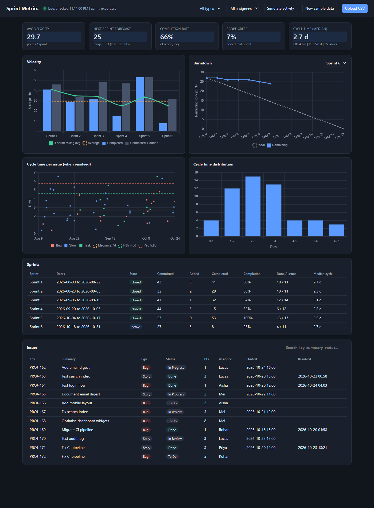

# Sprint Metrics Analyzer

Reads a Jira-style CSV export and produces a velocity chart, per-sprint burndown charts, cycle time stats and a markdown sprint report. Python 3.10+, standard library only (charts are plain SVG).



## Live dashboard (localhost)

```bash
python sprint_metrics.py --serve
```

Opens http://localhost:8000. The server watches the CSV and the page updates itself within ~2 seconds of any change, whether you save the file from Excel, drop a fresh Jira export over it, or use the buttons:

- **Upload CSV** (or drag and drop a file onto the page) replaces the data.
- **Simulate activity** moves one issue of the active sprint forward (To Do, In Progress, Done) so you can watch velocity, burndown and cycle time react.
- **New sample data** regenerates 6 sprints, the last one still in progress.
- Filters by issue type and assignee, a sprint picker for the burndown, a searchable and sortable issue table, hover tooltips on every chart, dark mode.

Charts use Chart.js from a CDN, so the page needs internet access on first load. Flags: `--port`, `--input`, `--no-open`.

## Static report

```bash
python sprint_metrics.py
```

If `data/sprint_export.csv` does not exist, 6 sprints of sample data are generated first. Output goes to `output/`:

- `sprint_report.md` - highlights, tables, embedded charts
- `charts/velocity.svg`, `charts/burndown_sprint_N.svg`, `charts/cycle_time.svg`

## Options

| Flag | Meaning |
|---|---|
| `--input FILE` | CSV to analyze (default `data/sprint_export.csv`) |
| `--output DIR` | output directory (default `output`) |
| `--generate` | regenerate the sample data |
| `--sprint "Sprint 3"` | sprint featured in the report's burndown (default: last) |

## CSV columns

`Issue key, Summary, Issue Type, Status, Story Points, Assignee, Sprint, Sprint Start, Sprint End, Created, Started, Resolved`

Dates are `YYYY-MM-DD HH:MM` (sprint dates `YYYY-MM-DD`). `Started` is when the issue entered In Progress; `Resolved` is blank for unfinished work. A raw Jira export needs its columns renamed/mapped to these.

## Metrics

- **Committed**: points on issues created on or before sprint start; **Added**: created later (scope creep).
- **Velocity**: points on issues resolved within the sprint dates.
- **Burndown**: remaining points at end of each sprint day vs an ideal line from committed scope.
- **Cycle time**: Started to Resolved in calendar days (mean, median, P85, P95).
